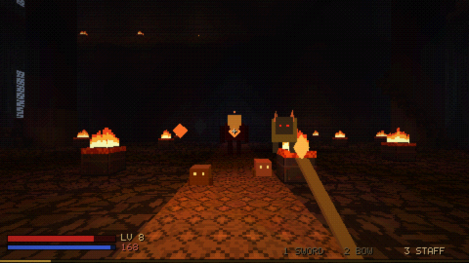
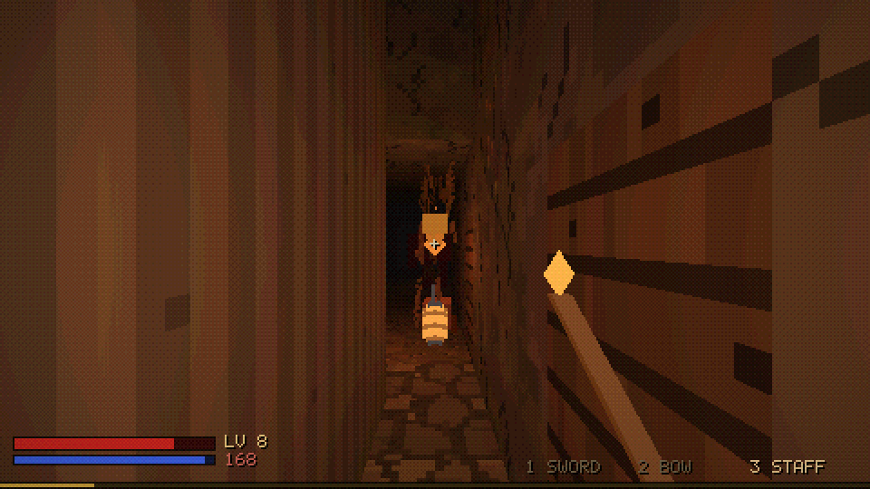
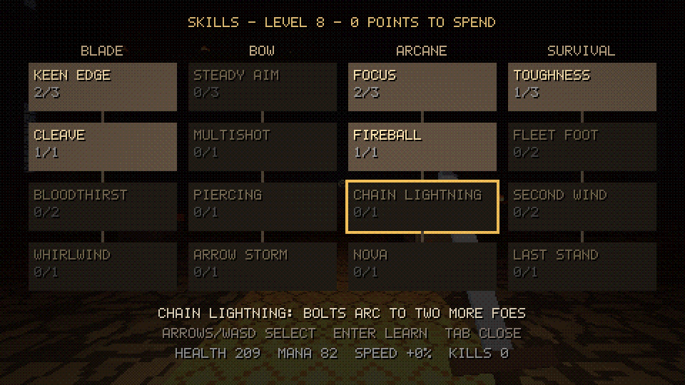
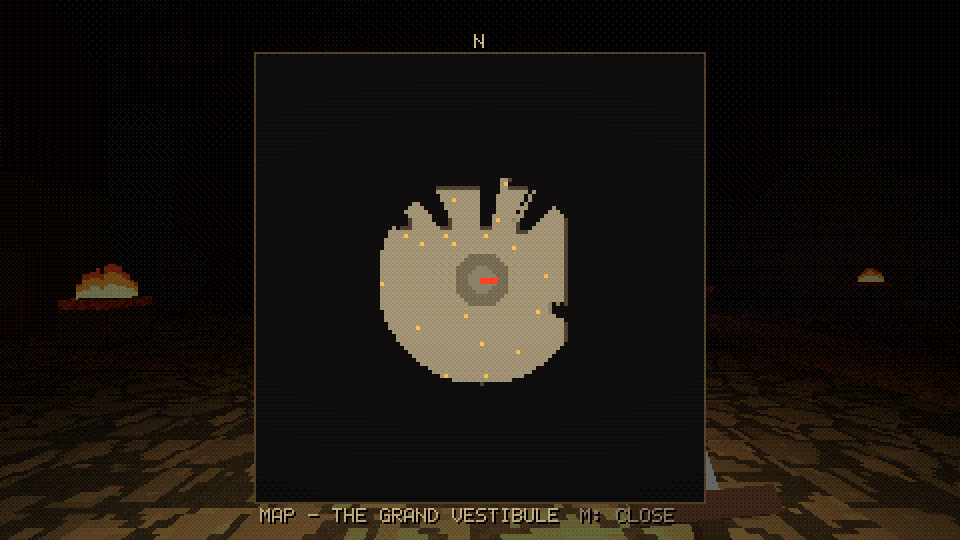

# Fortress Crawl

An endless, procedurally generated 3D dungeon crawler in C (C11) using SDL3 and OpenGL 3.3.
You start in front of a huge castle built into a mountain. Everything behind the gate is
generated on the fly, without end, in every direction including up and down. The farther you
get from the gate, the more dangerous it gets.

This is an early prototype. It has **world generation, lighting, the retro renderer,
Hexen-style combat against primitive monsters, a classless skill tree, shrines and an
explored-cells map**. There is no loot, saving or audio yet. See [`docs/PLAN.md`](docs/PLAN.md)
for the full plan.

## Screenshots (prototype, seed 1337)

| | |
|---|---|
|  |  |
| Before the gates | The Grand Vestibule |
|  |  |
| A great hall in the mines | A chasm with ledges and stairs |
|  |  |
| Heaven (far up) | Ember-forged dungeon (far south) |
|  |  |
| Jade dungeon (far east) | Gothic dungeon (west) |
|  |  |
| A pack with an elite brute in the vestibule | A brute in a mine tunnel |
|  |  |
| Classless skill tree (TAB) | Map of explored cells (M) |

## Build

Requirements: a C11 compiler, CMake 3.16+, and OpenGL 3.3 drivers. SDL3 is used from the
system if CMake can find it; otherwise it is downloaded and built automatically.

```bash
cmake -S . -B build -DCMAKE_BUILD_TYPE=Release
cmake --build build -j
./build/fortress_crawl
```

On Linux, building SDL3 from source needs the X11 and GL development packages. On
Ubuntu (also inside WSL):

```bash
sudo apt install libx11-dev libxext-dev libxi-dev libxfixes-dev libxrandr-dev libxcursor-dev libxss-dev libgl-dev libegl-dev
```

`libxi-dev` (XInput2) matters: without it SDL3 has no relative mouse mode on X11, and
CMake prints a warning. If you installed it after a first build, delete `build/` and
configure again so SDL3 is rebuilt.

### Mouse under WSL (WSLg)

WSLg passes the Windows cursor to Linux as absolute positions and cannot lock it to the
window. The game detects WSL and stops SDL from re-centring the cursor, because under
WSLg those re-centring jumps come back as motion in the opposite direction (inverted,
jittery look). The cursor is then not locked to the window; that is a WSLg limitation.
If relative mouse mode is missing entirely, the game falls back to grabbing the cursor
itself. You can override the detection with `--recenter` / `--no-recenter`, and
F7 / F8 invert the mouse's Y / X axis. For the best experience, build natively on
Windows or play the web version.

## Web version

The same code builds for the browser with Emscripten (WebGL 2, single-threaded; chunk
generation runs in time slices between frames):

```bash
source /path/to/emsdk/emsdk_env.sh     # Emscripten 4.0.10 was used
./web/build.sh                         # -> build-web/dist: index.html, index.js, index.wasm
python3 -m http.server -d build-web/dist 8000
```

Open http://localhost:8000 and click into the page to lock the mouse; Esc releases it.

### Deployment to Cloudflare Pages

`.github/workflows/build.yml` builds the desktop version with tests and the web
version on every push. If the repository has these two secrets, it also deploys the web
version to the Cloudflare Pages project `fortress-crawl` (created on first run):

- `CLOUDFLARE_API_TOKEN`: an API token with the *Cloudflare Pages: Edit* permission
  (Cloudflare dashboard -> My Profile -> API Tokens -> Create Token)
- `CLOUDFLARE_ACCOUNT_ID`: shown on the dashboard's Workers & Pages overview

Pushes to `main` go to production (`fortress-crawl.pages.dev`); other branches get
preview URLs.

## Controls

| Key | Action |
|-----|--------|
| WASD / mouse | move / look |
| Left / right mouse button | attack / alternate attack (unlocked by skills) |
| 1, 2, 3 or mouse wheel | sword, bow, staff |
| TAB | skill tree (arrows or WASD to select, Enter to learn) |
| M | map of the cells you have seen |
| Space, Shift, Ctrl | jump, sprint, crouch (you duck and crawl automatically in low tunnels) |
| F | fly / noclip (Space up, Ctrl down, Shift fast) |
| T | jump 8 chunks ahead in the view direction (enables fly) |
| Page Up / Page Down | one chunk (32 m) up / down |
| F1 | debug overlay (position, danger level, chunk and monster counts) |
| F2 | internal resolution 320x180 / 480x270 / 640x360 |
| F3 / F4 | ordered dithering / PS1-style vertex snapping |
| F5 / F6 | full-bright (inspect the generator) / player torch |
| F7 / F8 | invert mouse Y / X |
| - / = | mouse sensitivity down / up |
| F12 | save `screenshot.bmp` (desktop only) |
| Esc | release the mouse (press again to quit) |

Command line:

```
fortress_crawl [--seed N] [--pos x y z] [--look yaw pitch] [--fly] [--radius n] [--vradius n]
               [--window w h] [--lowres w h] [--debug]
               [--invert-x] [--invert-y] [--sens s] [--recenter | --no-recenter]
               [--shot file.bmp] [--shot-time seconds] [--demo combat|sword|death|skills|map]
```

`--shot` waits until the view has loaded, saves one frame and exits. It is useful for
comparing seeds and changes to the generator. `--demo` sets up a scene for that frame: a
level-8 character facing a monster pack (`combat`, `sword`, `death` with 1 HP), or the `skills` or `map`
screen.

Shrines (glowing rune stones) are respawn points: walk up to one to attune it. When you die,
you return to the last attuned shrine and keep everything.

## Tools and tests

```bash
./build/test_worldgen [seed]     # determinism, portal alignment, reachability, meshing
./build/worldmap places 0 20 places.ppm        # stratum/flavor map of one chunk layer
./build/worldmap section 0 20 section.ppm      # vertical slice through the world
./build/worldmap blocks 6 -100 -60 200 floor.ppm  # top-down block map of a world layer
```

## Code layout

```
src/core     hashing, RNG, noise, math (no dependencies)
src/engine   GL loader, shaders, bitmap font, worker threads
src/world    themes, texture generator, world layout, chunk generators, mesher + lighting,
             chunk streaming
src/render   low-res renderer, sky, post-processing, entity/UI batches
src/game     player controller, physics, monsters and AI, combat, skills, map
tests, tools headless generator checks and map exporters
```
