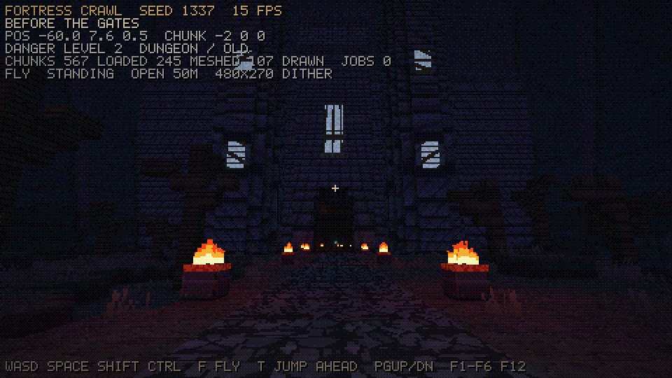
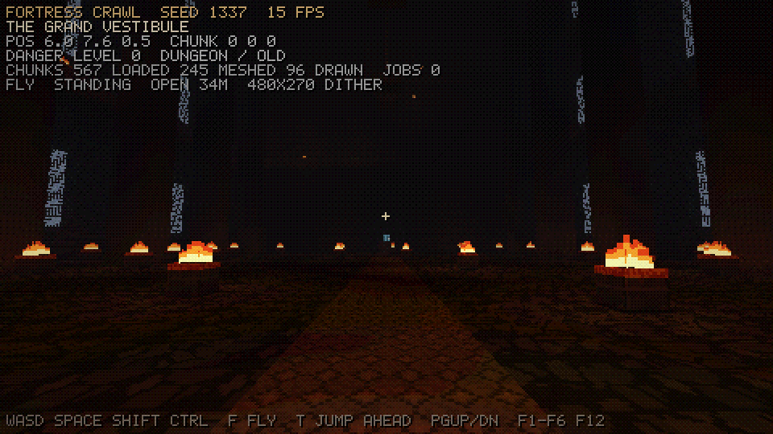
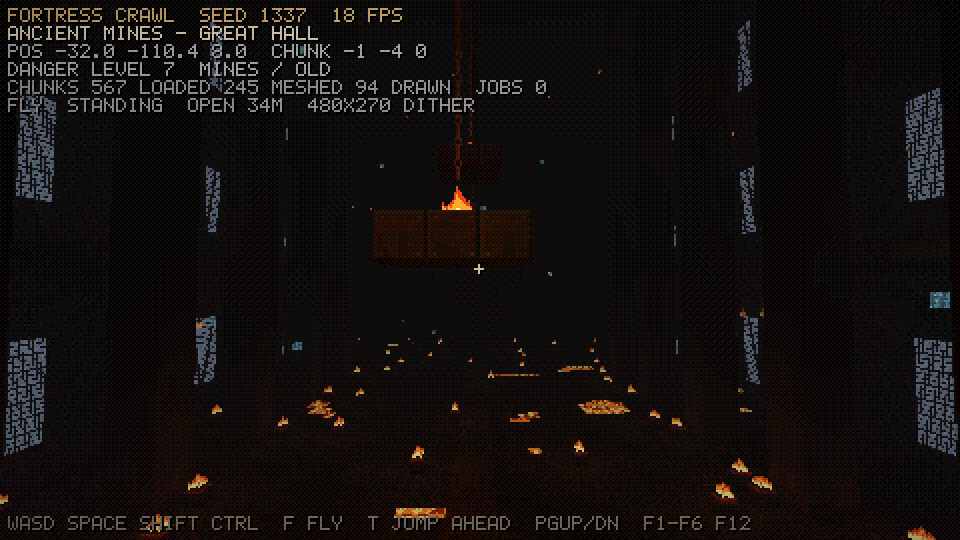
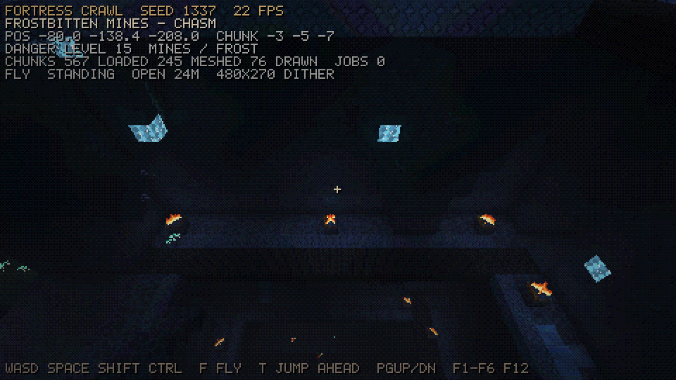
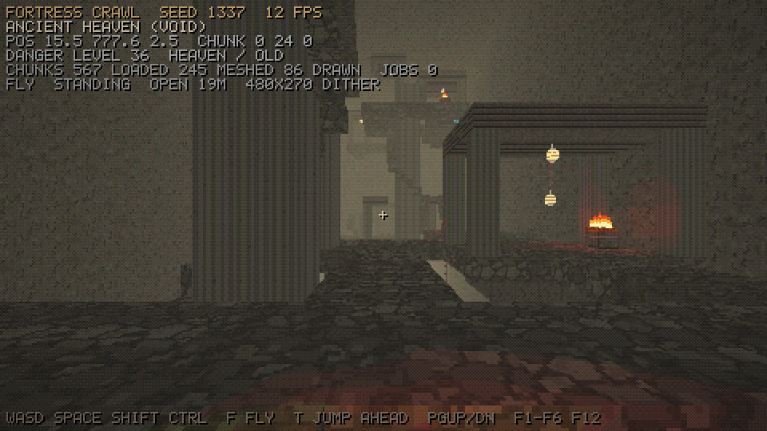
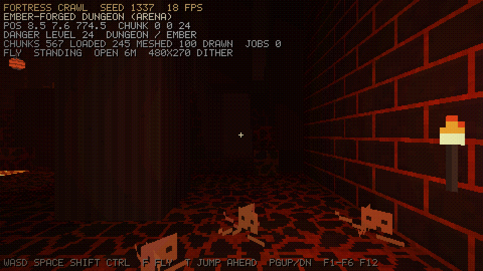
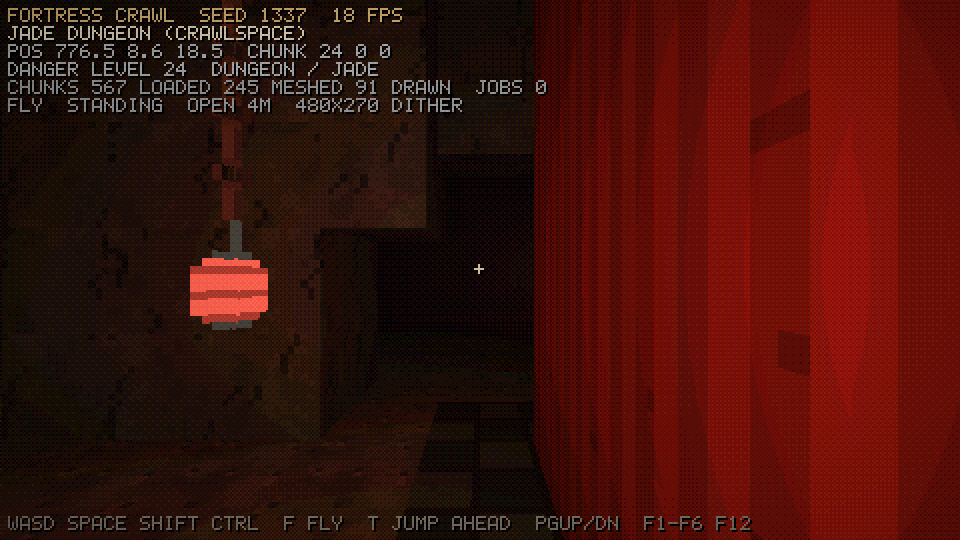
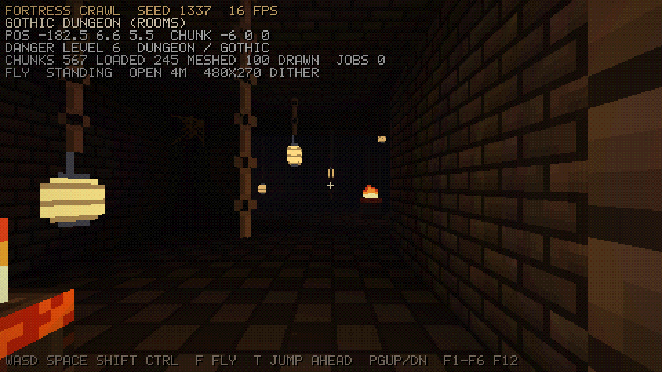

# Fortress Crawl

An endless, procedurally generated 3D dungeon crawler in C (C11) using SDL3 and OpenGL 3.3.
You start in front of a huge castle built into a mountain. Everything behind the gate is
generated on the fly, without end, in every direction including up and down. The farther you
get from the gate, the more dangerous it gets.

This is an early prototype. It covers **world generation, lighting and the retro renderer**.
There is no combat yet. See [`docs/PLAN.md`](docs/PLAN.md) for the full plan.

## Screenshots (prototype, seed 1337)

| | |
|---|---|
|  |  |
| Before the gates | The Grand Vestibule |
|  |  |
| A great hall in the mines | A chasm with ledges and stairs |
|  |  |
| Heaven (far up) | Ember-forged dungeon (far south) |
|  |  |
| Jade dungeon (far east) | Gothic dungeon (west) |

## Build

Requirements: a C11 compiler, CMake 3.16+, and OpenGL 3.3 drivers. SDL3 is used from the
system if CMake can find it; otherwise it is downloaded and built automatically.

```bash
cmake -S . -B build -DCMAKE_BUILD_TYPE=Release
cmake --build build -j
./build/fortress_crawl
```

On Linux, building SDL3 from source needs the usual X11/Wayland and GL development
packages, for example on Ubuntu: `libx11-dev libxext-dev libgl-dev libegl-dev`.

## Controls

| Key | Action |
|-----|--------|
| WASD / mouse | move / look |
| Space, Shift, Ctrl | jump, sprint, crouch (you duck and crawl automatically in low tunnels) |
| F | fly / noclip (Space up, Ctrl down, Shift fast) |
| T | jump 8 chunks ahead in the view direction (enables fly) |
| Page Up / Page Down | one chunk (32 m) up / down |
| F1 | debug overlay |
| F2 | internal resolution 320x180 / 480x270 / 640x360 |
| F3 / F4 | ordered dithering / PS1-style vertex snapping |
| F5 / F6 | full-bright (inspect the generator) / player torch |
| F12 | save `screenshot.bmp` |
| Esc | release the mouse (press again to quit) |

Command line:

```
fortress_crawl [--seed N] [--pos x y z] [--look yaw pitch] [--fly] [--radius n] [--vradius n]
               [--window w h] [--lowres w h] [--shot file.bmp] [--nohud]
```

`--shot` waits until the view has loaded, saves one frame and exits. It is useful for
comparing seeds and changes to the generator.

## Tools and tests

```bash
./build/test_worldgen [seed]     # determinism, portal alignment, reachability, meshing
./build/worldmap places 0 20 places.ppm        # stratum/flavor map of one chunk layer
./build/worldmap section 0 20 section.ppm      # vertical slice through the world
./build/worldmap blocks 6 -100 -60 200 floor.ppm  # top-down block map of a world layer
```

## Code layout

```
src/core     hashing, RNG, noise, math (no dependencies)
src/engine   GL loader, shaders, bitmap font, worker threads
src/world    themes, texture generator, world layout, chunk generators, mesher + lighting,
             chunk streaming
src/render   low-res renderer, sky, post-processing
src/game     player controller
tests, tools headless generator checks and map exporters
```
