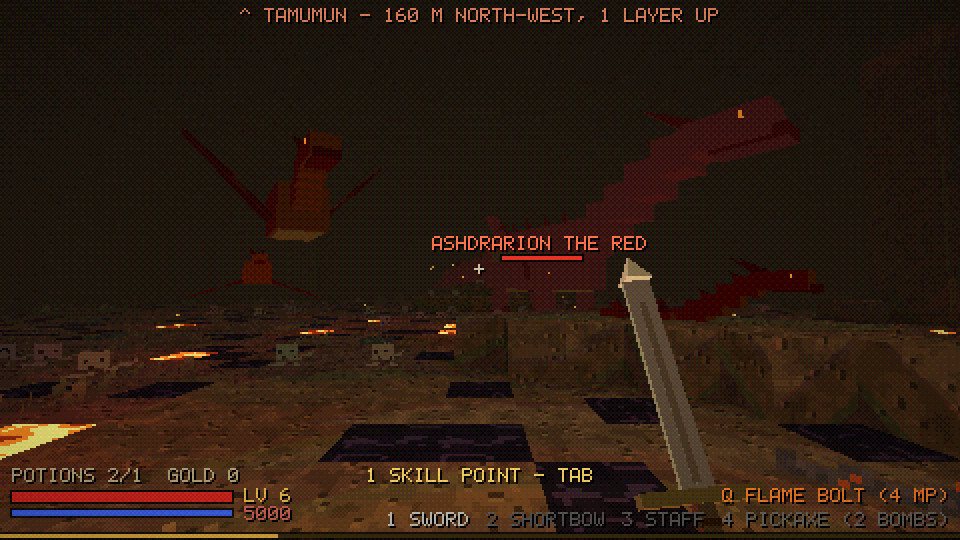
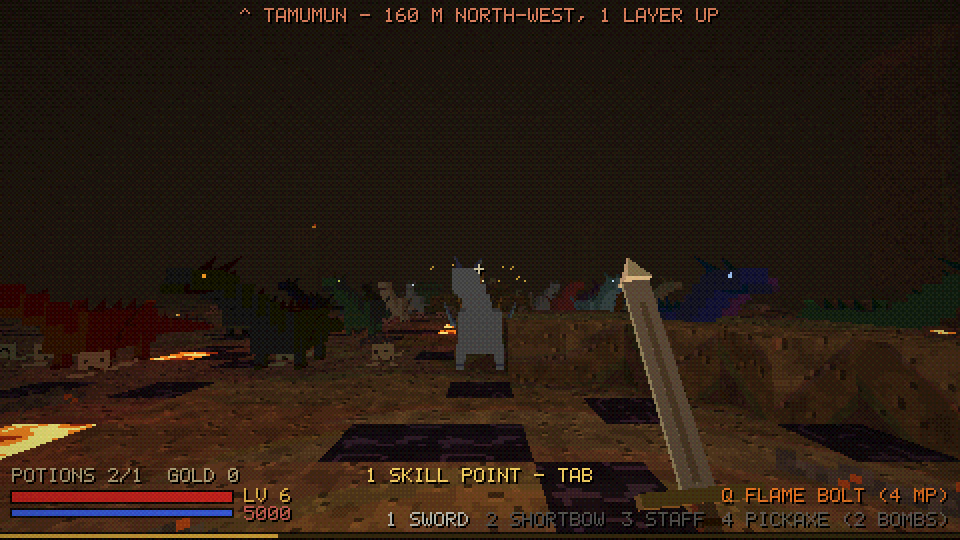

# Dragons

The hardest enemies of the fortress: huge, terrifying, with tons of loot. They are enemies only;
there are no dragon companions or mounts.

## Sizes

| Size | Scale | How it fights | Where |
|---|---|---|---|
| **Dragonet** | cat-sized, swarms of 6-10 | flits round you, bites, spits sparks of its element | packs from danger 5 |
| **Drake** | a horse's size, no wings, packs of 3-5 | charges and bites, a short breath | packs from danger 5; a lair's brood |
| **Wyvern** | 6-8 m across | circles overhead, dives and stings (poison), climbs away | packs from danger 12; a lair's brood |
| **Dragon** | 15-25 m | a boss in its lair: flight, breath runs, bite, tail and stomp; three phases | about one in five one-layer halls and caverns from danger 9 |
| **Ancient wyrm** | 40 m and more | the same, harder still, and the world shakes | about one lair in five |

A pack of dragons takes the place of the usual pack in about one chunk in eighteen from danger
5, in the fortress and in the realms behind the Gate (each realm has its kind of dragon).

## Kinds

Twenty-five, each with its own colours, breath, traits and the depths it lives at:

| Kind | Breath | Trait | Lives in |
|---|---|---|---|
| red | fire: burns, sets wood and grass alight | | inferno, sun court, castle |
| magma | molten rock that pools | armoured until the second phase | core, maw, iron hells |
| white | frost: freezes water, chills | | spires, aeries, mines |
| blue | lightning: twice as bad on the wet | | stormcrown, spires |
| green | a cloud of poison gas | | roots, gardens |
| black | acid that pools and eats stone | | ossuary, limbo, dungeon |
| swamp | rot (marsh gas) | | roots, fungal deep |
| gold | holy flame | mends itself when left a moment | heaven, sun court |
| crystal | beams of light | | crystal abyss |
| amethyst | force: throws you back | | crystal abyss, orrery |
| shadow | shadow | vanishes and comes back behind you; its lair is dark | limbo, ossuary |
| bone (dracolich) | death: the dead rise where it breathes | rises once more unless it burns | ossuary, limbo |
| iron (clockwork) | steam | armoured until the second phase | orrery, iron hells |
| rust | rust: it slows you | | iron hells, mines |
| sand | scouring sand: it blinds and slows | | the maw |
| sea | a wave that throws you | | the dungeon's waters |
| cloud | wind | vanishes in its fog | clouds, aeries |
| void | the void pulls you in | blinks away and back | astral void |
| the three moon dragons | moonlight, rust, void | the black one brings the dark | the moons behind the Gate |
| hydra | poison and acid, from three to five heads | no wings | roots, fungal deep, maw |
| twin-headed | fire and frost at once | two heads | castle, dungeon, heaven |
| wyrm | sand | no wings; burrows and bursts up under you | maw, core, mines |
| chaos | a different element every time | vanishes | core, astral void |

Breath goes through the simulation, so the world remembers it:
- fire scorches and sets things burning
- frost freezes water
- lightning arcs along metal and water
- poison, rot and steam drift as gas
- acid and magma pool and eat stone
- a dracolich's breath raises skeletons

## How a great dragon fights

- **Asleep on its hoard.** It wakes if you come too close standing (12 m; 5 m crouched), step on
  its gold (sneak, and it may still wake), or strike it. It roars: the view shakes and every
  monster near wakes.
- **In the air** it circles you high, makes **breath runs** along a line through you, and
  breathes from on high. A blow from below hits its soft belly (+40 %). Wounds to its wings
  **tear them**, and then it cannot fly again.
- **On the ground**:
  - it bites and claws in front
  - it sweeps its tail at whoever is behind it and throws them
  - it stomps beside it (the ground shakes, stones fall)
  - it rears with a glowing throat and breathes, every head of a hydra at once

  Its tread shakes the view.
- **Three phases**:
  1. in the air
  2. **furious**: it lands, faster and fiercer
  3. **desperate**: the lair comes down, and stones fall round you all the time
- Wyrms burrow and burst up under you. Shadow, cloud, void and chaos dragons vanish and come back
  behind you. A dracolich rises once more unless it was burning when it fell.
- It does not chase you out of its lair. Run, and it flies home, heals and sleeps again.

## Loot

- **The hoard**, in the middle of the lair. Each piece is taken once and stays taken:
  - 14 piles of gold (24 for an ancient) to walk through
  - 3 chests (6)
  - one of this world's legendaries not found yet (two for an ancient)
  - a **dragon-slayer's blade**: a legendary of the dragon's region
- **The dragon itself**:
  - a pile of gold
  - two or three rich loot drops and a boss's weapon
  - **its heart** (a titan heart for the forge)
  - **its scales** (three to six essences of its element)
  - **teeth**
  - **its blood** (phoenix ash from fire dragons, a heartstone from the rest)
  - an ancient also leaves a legendary weapon
- A slain dragon stays dead: its lair is saved (save version 27). Its skull hangs in the Sanctum's
  armory and the world calls you **dragonslayer**.
- Drakes and wyverns leave teeth and essences now and then.

## Sounds

Sixteen new sound effects, made with the ElevenLabs sound effect generator (`tools/sfx_list.mjs`):
- roars of three sizes
- wing beats and the tread of a great dragon
- tail sweep and bite
- the indrawn breath
- five breaths: fire, frost, storm, gas, acid
- hurt and death
- the dragonet's screech

## How it is built

- `src/world/dragons.h`, `dragons.c`: the data, the generated names ("Ashdrarion the Red"), the
  kind for a stratum or a realm, and the plan of a lair.
- `src/world/layout.c`: lairs are halls of variant `HALL_LAIR`, 3 × 3 chunks, the kind stored in
  the structure.
- `src/world/gen_lair.c`: the cave under its dome, the hoard mound, four perches, bones, and the
  marks of the breath (obsidian and lava, ice, crystal, fungus and pools, ore, water). Lairs have
  a dim glow of their own, except the dark ones.
- `src/game/dragon.c`:
  - spawning: a lair's dragon, brood and hoard; packs
  - the minds of the small and the great
  - breath and its effects
  - flight and walking
  - wounds, wings and the dracolich's rising
  - loot
  - the model: body, neck and head with a moving jaw, tail, legs, wings with membranes, many
    heads, the wyrm's coils, its shadow in flight
  - shaking and falling stones
- `tests/test_worldgen.c` checks that there are lairs within reach and that each has room to fly
  over its hoard.
- Demos:
  - `--demo lair`: the nearest lair
  - `--demo dragons --cast K`: the sizes of kind K
  - `--demo dragonkinds`: every kind
  - `--demo dragonfight`: a lair's dragon woken and wounded to death, with every phase logged
