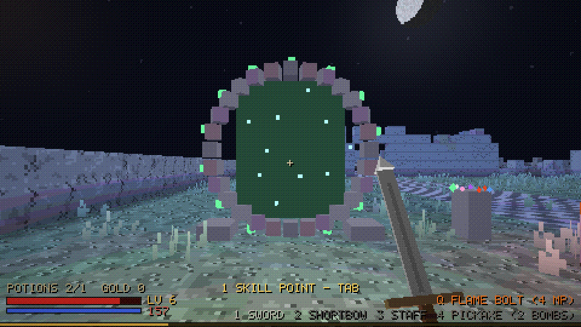
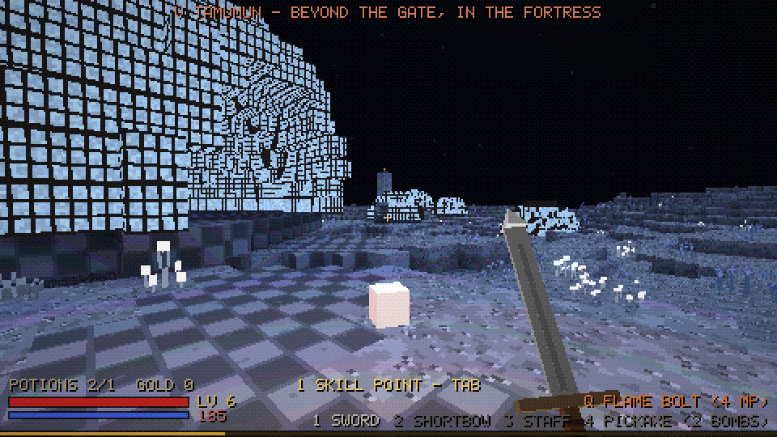
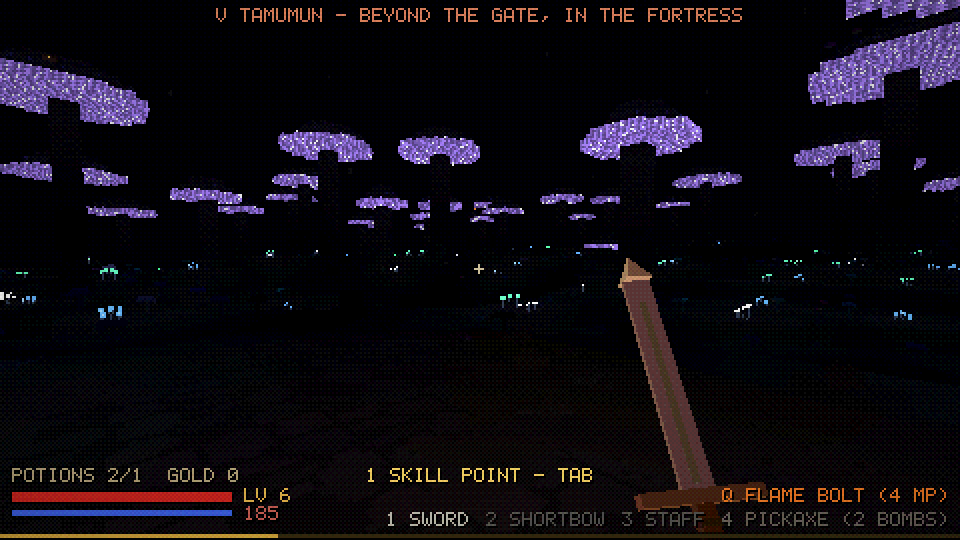
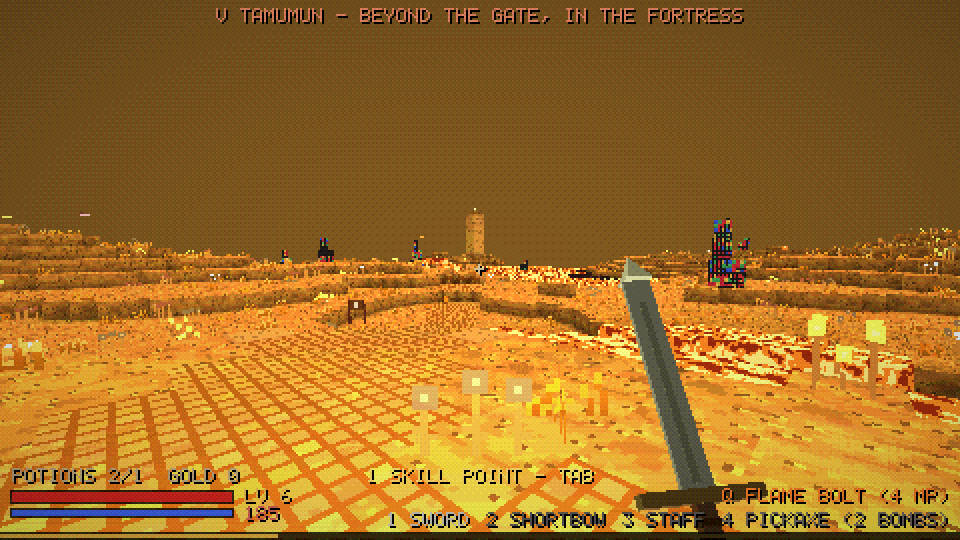
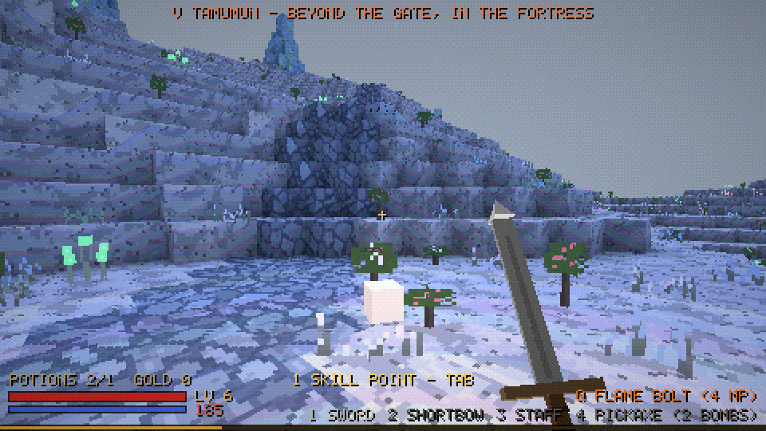
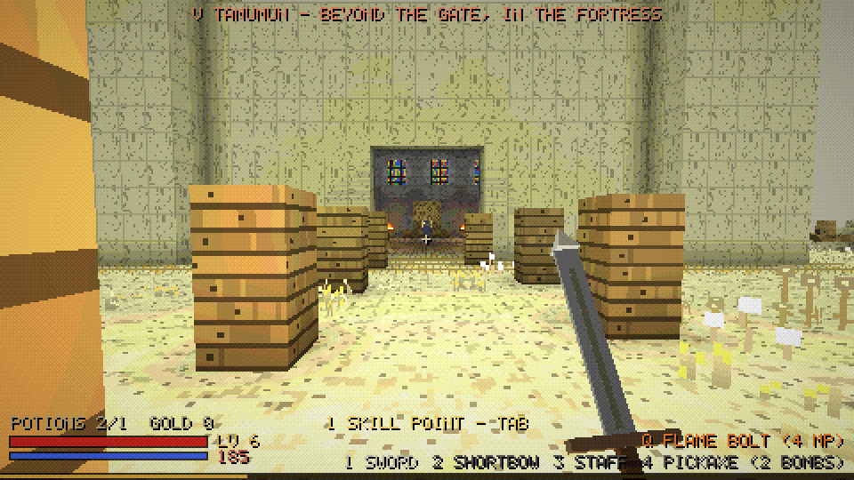
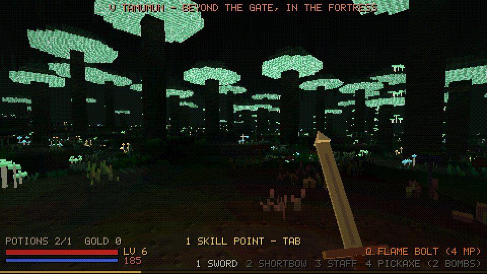
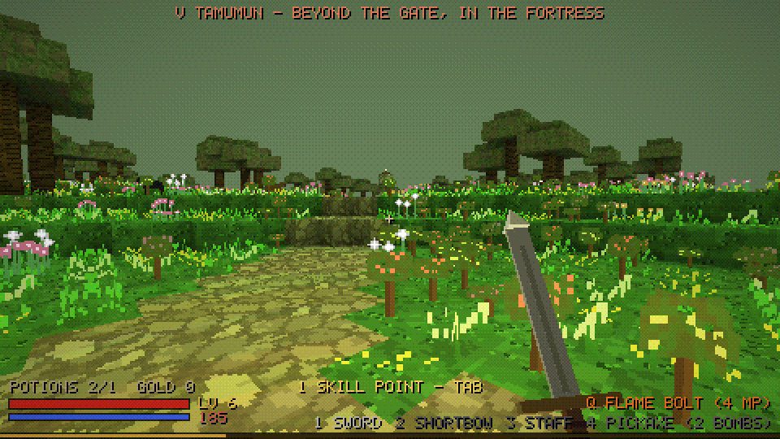
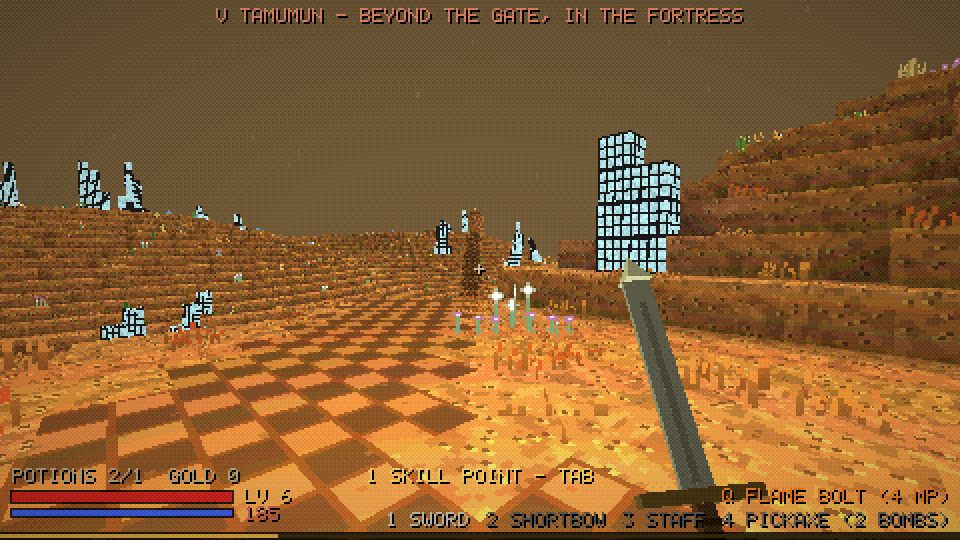

# The realms behind the Gate

Twenty-one other worlds lie beyond the fortress. They include the three moons and the keeps of their wizard-kings, the
fortress at the heart of the sun, the keep under the ocean and the icelands. Each fortress (each world seed) is
joined to **six to eight** of them, chosen at random by the seed. All twenty-one are built; which ones a world
gets is part of what makes that world its own.

## Getting there

- **Rifts.** About one fortress chunk in thirty holds a rift, a jagged tear of light in the realm's colour. A rift
  leads to the joined realm whose danger is closest to the chunk's own, so you meet the gentle realms near the
  gate and the deadly ones far out. The Grand Vestibule always has one, to the gentlest joined realm. Walking
  into a rift **attunes** the Gate to its realm and takes you through.
- **The Gate.** A ring of stone in the Sanctum's court, west of the path home. Strike the dial stone beside it
  to turn it to the next joined realm (the dial shows them all, lit if attuned). Walk through the ring to go to
  the realm it shows, if the Gate is attuned to it.
- **Back.** In every realm you arrive in front of an arch with a swirl of light. Walk back through it to return
  where you came from: the rift, or the Gate. If you fall out of a realm you are put back at the arch.
- **Sealed realms.** The Astral Shore opens only after the end of the story. The Dream of the Sleeper opens only
  after an end that spared. Their rifts show, thin and closed, until then.

Attunement, the rulers you have beaten, the realms you have seen and the plants and animals you have met are
saved with the world (save version 25), as is where you went through from.

## In a realm

Every realm is 256 m on a side, walled in by rock or open sky, with a gate arch at one corner and its ruler's
keep near the other. A paved road links the two (a glass tunnel under the ocean, a causeway over the Sea of
Night, bridges between the islands in the sky). The land's shape, its look, its sky light, its fog and its
temperature are its own:

- **Danger.** Each realm has its own monster level (3 for the Garden up to 30 for the Astral Shore). Its
  monsters are the fortress's kinds, in the realm's colours. A realm's *rank*, which makes monsters tougher and
  gives them an element, follows its danger and not its distance from the gate.
- **The ruler.** A boss waits in the keep (the Silver King, the Forgemaster, the Drowned Queen, the Clockmaker,
  your Reflection...). Beaten, a ruler stays beaten and leaves two keystones, a reagent from each of the realm's
  animals and a boss's loot.
- **Its rules.** Weight (0.4 on the Pale Moon, 0.12 on the Astral Shore, shifting in the Dream). No air outside
  the domes on the Pale Moon: breath runs out as under water. The Sun burns you without a sun-ward. Lightning
  strikes in the Storm Peaks unless a lightning tree or a metal rod near you takes it. Wind, sand and rust
  storms. The Sea of Night's tide follows the moons, and at high water the waves sweep the causeway to the keep.
  The Glass Desert has scorching days and freezing nights. In the Fungal Deep spores drift and the mycelium tells
  the monsters where you step. Rot rises in the Bone Fields. On the Fallen Star the crystal drinks your mana. In
  the Garden of the First Seed everything grows twenty times as fast.
- **The story.** Every realm is tied to the world's history. Its story line, shown when you first arrive and kept
  in the STORY tab, names the fortress, its builders, what was sealed below and the night it fell. The Library of
  Ash's page trees answer a question of the history. The memory doves of the Shining Court recall facts of it,
  the book worms recite clues, and the mirror cat shows your deeds undone. In the Clockwork Orrery, striking the
  throne turns the moons, and the fortress has an eclipse for ten minutes.
- **The shop.** Once the Gate is attuned to any realm, the shop sells a **sun-ward salve** (twenty minutes the Sun
  does not burn) and a **gill draught** (twenty minutes your breath lasts five times as long under water).

## Plants and animals

Every realm has **three plants and three animals of its own, each in three variants**: 63 species of each, 189
variants of each.

- **Plants** are three blocks, `B_RFLORA_LOW`, `B_RFLORA_TALL` and `B_RFLORA_GLOW` (the last one glows). What they
  look like comes from the realm of the chunk's theme. Each species has a shape (tufts, blooms, reeds, cacti,
  ferns, caps, spikes, kelp, pods, saplings, orbs, page-trees), a stem colour and a colour for each variant,
  drawn into the theme's textures (`texgen.c`). They grow in patches, spread to the bare earth beside them, burn,
  and when broken give food, a reagent and their effect: air, healing, mana, warmth, a sun-ward, seeds, spores, a
  shock, or a page. Thorny ones hurt to walk through, and the mycelium wakes the monsters.
- **Animals** are drawn from ten body plans (four-legged, hopper, bird, flyer, fish, crawler, serpent, jelly,
  whale, strider) at their size, in the colour of their variant, some with glowing parts. A herd is mostly one
  variant with a few of the others among them. Shy animals flee, calm ones go about their business, and fierce
  ones come for you when you are close or have hurt them. Hunted, they give their food and their reagent. Some
  have something to tell when you strike at them face to face: the memory dove, the book worm, the mirror cat.

## The twenty-one realms

| | | |
|---|---|---|
|  |  |  |
| the Pale Moon: domes, moonglass bells | the Black Moon: only what lives gives light | the heart of the Sun: rivers of light |
|  |  |  |
| the Icelands: frost-berries, aurora bells | the Shining Court: the Hall of Names on the clouds | the Fungal Deep: stalk-caps and lantern morels |
|  |  | |
| the Garden of the First Seed | the Glass Desert: glass cacti and shards | |

| # | Realm | Danger | Land | Weight | Temp. | Rules | Ruler |
|---|---|---|---|---|---|---|---|
| 0 | The Pale Moon | 6 | crater | 0.4 | -8 | no air outside the domes | the Silver King (the Silver Keep) |
| 1 | The Red Moon | 10 | crater | 0.5 | 22 | sand or rust storms | the Ember King (the Ember Keep) |
| 2 | The Black Moon | 16 | crater | 0.45 | 4 | no sky light | the Hollow King (the Hollow Keep) |
| 3 | The Fortress at the Heart of the Sun | 26 | plain | 1 | 55 | burns without a sun-ward | the Sun Regent (the Sun Court) |
| 4 | The Forge-World | 20 | peaks | 1 | 38 | - | the Forgemaster (the Anvil Keep) |
| 5 | The Glass Desert | 8 | dunes | 1 | 20 | scorching days, freezing nights, sand or rust storms | the Exile (the Exile's Tower) |
| 6 | The Keep under the Ocean | 14 | deep | 1 | 8 | - | the Drowned Queen (the Drowned Keep) |
| 7 | The Icelands | 5 | peaks | 1 | -22 | wind | the Frost Jarl (the Frozen Hall) |
| 8 | The Sea of Night | 9 | sea | 1 | 6 | tides | the Tide Warden (the Tide Keep) |
| 9 | The Storm Peaks | 18 | isles | 1 | 2 | lightning, wind | the Storm Lord (the Thunder Eyrie) |
| 10 | The Shining Court | 12 | isles | 0.8 | 16 | - | the Herald of Names (the Hall of Names) |
| 11 | The Astral Shore | 30 | isles | 0.12 | -4 | near weightless, opens after the finale | the Keeper of the Shore (the Last Lighthouse) |
| 12 | The Hollow Earth | 11 | cavern | 1 | 24 | - | the First Elder (the Walled Hall) |
| 13 | The Fungal Deep | 7 | cavern | 1 | 14 | spores; the mycelium alerts monsters, no sky light | the Mushroom Elder (the Spore Throne) |
| 14 | The Bone Fields | 13 | plain | 1 | 10 | miasma | the Bone Sovereign (the Ossuary Crown) |
| 15 | The Clockwork Orrery | 15 | isles | 1 | 12 | - | the Clockmaker (the Brass Observatory) |
| 16 | The Library of Ash | 10 | plain | 1 | 18 | - | the Archivist (the Burned Archive) |
| 17 | The Garden of the First Seed | 3 | plain | 1 | 20 | growth x20 | the Gardener (the Gardener's Lodge) |
| 18 | The Fallen Star | 17 | crater | 0.8 | 10 | crystal drains mana | the Star-Touched (the Crater Keep) |
| 19 | The Mirror Fortress | 22 | mirror | 1 | 12 | no sky light | your Reflection (the Mirror Throne) |
| 20 | The Dream of the Sleeper | 28 | dream | 1 | 12 | shifting weight, opens after a finale that spared | the Sleeper (the Sleeper's Bed) |

### 0. The Pale Moon (danger 6)

Low weight, no air outside the domes. Frost lilies hold a breath.

| Plant | Variants | Grows | Gives |
|---|---|---|---|
| dust clover | grey, silver, pale blue | low | food |
| frost lily | white, blue, silver-veined | tall | a breath of air |
| moonglass bell | milky, opal, shining | glows | mana |

| Animal | Variants | Body | Temper | Size |
|---|---|---|---|---|
| dust hare | grey, silver, moon-white | hopper | shy | 1 |
| crater moth | pale, dusky, lunar | flyer | calm | 0.8 |
| regolith crab | grey, black, white | crawler | fierce | 1.3 |

### 1. The Red Moon (danger 10)

Rust storms, iron spires, and wyrms that eat the iron.

| Plant | Variants | Grows | Gives |
|---|---|---|---|
| rust lichen | orange, crimson, brown | low | food |
| blood-reed | dark, bright, black-tipped | tall | heals |
| ember thistle | red, orange, white-hot | glows | thorns: hurts to walk through |

| Animal | Variants | Body | Temper | Size |
|---|---|---|---|---|
| rust wyrm | rust, black-iron, scarlet | serpent | fierce | 2.2 |
| iron beetle | iron, copper, red | crawler | calm | 0.9 |
| red kite | red, brown, ember | bird | shy | 0.9 |

### 2. The Black Moon (danger 16)

No light but what lives. Fungus forests; the Herald came from here.

| Plant | Variants | Grows | Gives |
|---|---|---|---|
| shadow fern | black, violet, ink-blue | low | food |
| hollow cap | grey, violet, ghost-white | tall | spores |
| starlight puffball | blue, green, white | glows | light and a little mana |

| Animal | Variants | Body | Temper | Size |
|---|---|---|---|---|
| glimmer stalker | black, violet, eyeless | strider | fierce | 1.8 |
| lamp moth | green, blue, gold | flyer | calm | 0.9 |
| void hare | black, grey, starred | hopper | shy | 1 |

### 3. The Fortress at the Heart of the Sun (danger 26)

It burns without a sun-ward. Rivers of light, flowers of glass.

| Plant | Variants | Grows | Gives |
|---|---|---|---|
| sun-grass | gold, amber, white-gold | low | food |
| glass flower | clear, rose, smoky | tall | a sun-ward |
| flare blossom | yellow, orange, blue-white | glows | mana |

| Animal | Variants | Body | Temper | Size |
|---|---|---|---|---|
| phoenix | gold, crimson, white-flame | bird | fierce | 1.8 |
| corona lizard | orange, yellow, white | serpent | shy | 0.9 |
| sunray | gold, amber, rose | flyer | calm | 1.6 |

### 4. The Forge-World (danger 20)

Magma seas, star-iron and mithril in the rock. The keys were forged here.

| Plant | Variants | Grows | Gives |
|---|---|---|---|
| cinder moss | grey, glowing, black | low | warms |
| slag palm | iron, copper, tin | tall | food |
| forge-bloom | red, white, violet | glows | thorns: hurts to walk through |

| Animal | Variants | Body | Temper | Size |
|---|---|---|---|---|
| anvil tortoise | iron, bronze, mithril | four-legged | calm | 1.8 |
| spark salamander | red, yellow, blue | serpent | shy | 0.8 |
| slag hound | black, glowing, grey | four-legged | fierce | 1.5 |

### 5. The Glass Desert (danger 8)

Scorching days, freezing nights, sandstorms. Glass cacti hold water.

| Plant | Variants | Grows | Gives |
|---|---|---|---|
| sand sedge | tan, pale, rust | low | food |
| glass cactus | green, clear, blue | tall | thorns: hurts to walk through |
| mirage lotus | pink, blue, shimmering | glows | a sun-ward |

| Animal | Variants | Body | Temper | Size |
|---|---|---|---|---|
| sand worm | sand, glass, rust | serpent | fierce | 3 |
| dune fox | tan, white, red | four-legged | shy | 0.9 |
| glass scorpion | clear, amber, black | crawler | fierce | 1.1 |

### 6. The Keep under the Ocean (danger 14)

All under water. Air pods give a breath; a gill draught gives more.

| Plant | Variants | Grows | Gives |
|---|---|---|---|
| sea-grass | green, olive, red | low | food |
| giant kelp | brown, golden, green | tall | food |
| air pod | blue, white, green | glows | a breath of air |

| Animal | Variants | Body | Temper | Size |
|---|---|---|---|---|
| silver shoal | silver, blue, gold | fish | shy | 0.8 |
| drowned crab | green, black, barnacled | crawler | fierce | 1.4 |
| leviathan calf | grey, blue, pale | whale | calm | 4 |

### 7. The Icelands (danger 5)

Bitter cold and wind. The frozen dead remember, if you can warm them.

| Plant | Variants | Grows | Gives |
|---|---|---|---|
| snow moss | white, grey-green, blue | low | food |
| frost-berry bush | red, blue, white | tall | food |
| aurora bell | green, violet, rose | glows | warms |

| Animal | Variants | Body | Temper | Size |
|---|---|---|---|---|
| snow goat | white, grey, shaggy | four-legged | shy | 1.3 |
| ice wolf | white, blue-grey, black | four-legged | fierce | 1.4 |
| frost owl | snowy, barred, blue | bird | calm | 1 |

### 8. The Sea of Night (danger 9)

The tide follows the moons. The causeway to the keep is open at low water.

| Plant | Variants | Grows | Gives |
|---|---|---|---|
| tide-weed | black, green, blue | low | food |
| moonreed | silver, grey, blue | tall | food |
| night-pearl lily | pearl, blue, violet | glows | mana |

| Animal | Variants | Body | Temper | Size |
|---|---|---|---|---|
| tide crab | black, blue, silver | crawler | shy | 0.9 |
| night heron | grey, black, white | bird | shy | 1.3 |
| moon jelly | blue, violet, white | jelly | calm | 1.2 |

### 9. The Storm Peaks (danger 18)

Lightning out of the sky, wind off the peaks. Lightning trees hold the charge.

| Plant | Variants | Grows | Gives |
|---|---|---|---|
| wind-grass | grey, green, blue | low | food |
| lightning tree | white, blue, violet | tall | holds a charge |
| static thistle | blue, yellow, white | glows | thorns: hurts to walk through |

| Animal | Variants | Body | Temper | Size |
|---|---|---|---|---|
| storm ray | grey, blue, charged | flyer | calm | 2 |
| crag ram | grey, brown, white | four-legged | shy | 1.4 |
| thunder hawk | slate, gold, black | bird | fierce | 1.2 |

### 10. The Shining Court (danger 12)

A cloud world of the dead of the history. The ledger, made visible.

| Plant | Variants | Grows | Gives |
|---|---|---|---|
| cloud clover | white, gold, rose | low | heals |
| ledger lily | ivory, gilt, black-inked | tall | mana |
| halo orchid | gold, white, sky-blue | glows | heals |

| Animal | Variants | Body | Temper | Size |
|---|---|---|---|---|
| memory dove | white, gold, grey | bird | calm | 0.8 |
| cloud lamb | white, gold-fleeced, rose | four-legged | shy | 1 |
| gilded carp | gold, white, red | flyer | calm | 1 |

### 11. The Astral Shore (danger 30)

No weight at all. Star whales. Open only after the end of the story.

| Plant | Variants | Grows | Gives |
|---|---|---|---|
| star moss | blue, violet, silver | low | food |
| comet fern | white, cyan, rose | tall | mana |
| nebula bloom | violet, teal, golden | glows | light and a little mana |

| Animal | Variants | Body | Temper | Size |
|---|---|---|---|---|
| star whale | indigo, silver, nebular | whale | calm | 6 |
| void minnow | blue, gold, clear | flyer | shy | 0.5 |
| astral strider | violet, white, starred | strider | calm | 2 |

### 12. The Hollow Earth (danger 11)

An inner sun, giant ferns, and the first people, walled in.

| Plant | Variants | Grows | Gives |
|---|---|---|---|
| sun-fern | green, yellow, bronze | low | food |
| giant horsetail | green, striped, red | tall | food |
| first-flame flower | orange, gold, red | glows | warms |

| Animal | Variants | Body | Temper | Size |
|---|---|---|---|---|
| cave ox | brown, white, dun | four-legged | calm | 2 |
| terror bird | green, blue, brown | bird | fierce | 2 |
| burrow lizard | green, sand, banded | serpent | shy | 1 |

### 13. The Fungal Deep (danger 7)

Spores in the air; the mycelium tells the monsters where you step.

| Plant | Variants | Grows | Gives |
|---|---|---|---|
| mycelium mat | white, yellow, pink | low | wakes the monsters when stepped on |
| stalk-cap | brown, red, blue | tall | spores |
| lantern morel | green, cyan, amber | glows | light and a little mana |

| Animal | Variants | Body | Temper | Size |
|---|---|---|---|---|
| spore slug | yellow, violet, spotted | crawler | calm | 1 |
| cap hopper | brown, red, white | hopper | shy | 0.8 |
| puff bat | grey, green, pink | flyer | fierce | 0.8 |

### 14. The Bone Fields (danger 13)

Giant skeletons, and rot that rises from them.

| Plant | Variants | Grows | Gives |
|---|---|---|---|
| marrow-grass | yellow, grey, red-stemmed | low | food |
| rib-thorn | bone, black, red | tall | thorns: hurts to walk through |
| corpse candle | green, blue, pale | glows | light and a little mana |

| Animal | Variants | Body | Temper | Size |
|---|---|---|---|---|
| bone vulture | black, bald, white-collared | bird | calm | 1.4 |
| carrion beetle | black, orange, green | crawler | calm | 0.8 |
| marrow jackal | tan, grey, spotted | four-legged | fierce | 1.2 |

### 15. The Clockwork Orrery (danger 15)

The moons on their rods. Turn them, and the fortress sees an eclipse.

| Plant | Variants | Grows | Gives |
|---|---|---|---|
| cog clover | brass, copper, steel | low | food |
| pendulum vine | brass, green, silver | tall | seeds |
| planet bud | blue, red, ringed | glows | mana |

| Animal | Variants | Body | Temper | Size |
|---|---|---|---|---|
| clockwork finch | brass, silver, copper | bird | shy | 0.6 |
| gear tortoise | brass, iron, verdigris | four-legged | calm | 1.5 |
| orbit moth | blue, gold, red | flyer | calm | 0.8 |

### 16. The Library of Ash (danger 10)

Shelves in the ash. The pages answer questions of the history.

| Plant | Variants | Grows | Gives |
|---|---|---|---|
| ash fern | grey, black, ember-veined | low | food |
| page tree | parchment, vellum, charred | tall | a page that answers a question of the history |
| ember quill | red, orange, blue | glows | warms |

| Animal | Variants | Body | Temper | Size |
|---|---|---|---|---|
| book worm | grey, ink-black, gilt | serpent | calm | 1 |
| ink crow | black, blue-black, white | bird | shy | 0.9 |
| cinder cat | grey, black, ember | four-legged | shy | 0.8 |

### 17. The Garden of the First Seed (danger 3)

Things grow twenty times as fast. Rare seeds; the refuge of the spared.

| Plant | Variants | Grows | Gives |
|---|---|---|---|
| first-grass | green, gold, silver | low | seeds |
| seed tree | apple, pear, plum | tall | food |
| dawn-bloom | rose, gold, white | glows | heals |

| Animal | Variants | Body | Temper | Size |
|---|---|---|---|---|
| garden deer | fawn, white, dappled | four-legged | shy | 1.5 |
| honey bear | brown, gold, black | four-legged | calm | 1.8 |
| song thrush | brown, blue, red-breasted | bird | shy | 0.6 |

### 18. The Fallen Star (danger 17)

Star-iron in a crater, and crystal that drinks your mana.

| Plant | Variants | Grows | Gives |
|---|---|---|---|
| star-glass grass | clear, blue, violet | low | food |
| shard reed | blue, white, black | tall | thorns: hurts to walk through |
| mana-drinker | violet, cyan, white | glows | mana |

| Animal | Variants | Body | Temper | Size |
|---|---|---|---|---|
| crystal tick | blue, violet, clear | crawler | fierce | 0.8 |
| starling | black, speckled, white | bird | shy | 0.6 |
| glass stag | clear, blue, violet | four-legged | shy | 1.7 |

### 19. The Mirror Fortress (danger 22)

The fortress, the wrong way round. What you did, undone.

| Plant | Variants | Grows | Gives |
|---|---|---|---|
| backward grass | green, grey, silver | low | food |
| mirror reed | silver, black, gold | tall | food |
| reflect-bloom | white, black, rainbow | glows | mana |

| Animal | Variants | Body | Temper | Size |
|---|---|---|---|---|
| looking-glass hare | silver, black, white | hopper | shy | 1 |
| twin-headed hen | white, black, speckled | bird | shy | 0.9 |
| mirror cat | silver, black, gold-eyed | four-legged | calm | 0.8 |

### 20. The Dream of the Sleeper (danger 28)

Pieces of places, stitched. Gravity shifts. Open after a finale that spared.

| Plant | Variants | Grows | Gives |
|---|---|---|---|
| sleep poppy | red, violet, grey | low | heals |
| dream willow | blue, rose, pale | tall | mana |
| wish-light | gold, blue, green | glows | light and a little mana |

| Animal | Variants | Body | Temper | Size |
|---|---|---|---|---|
| dream fish | blue, rose, gold | flyer | calm | 1 |
| patchwork beast | striped, spotted, checked | four-legged | calm | 1.8 |
| nightmare hound | black, red-eyed, smoke | four-legged | fierce | 1.6 |

## How it is built

- `src/world/realms.h`, `realms.c`: the data. The realms (danger, land, liquid, weight, temperature, sky, fog,
  rules, story line), the 63 plants and 63 animals, which realms a seed joins (`realm_pick`), the land's
  height, and the places of the arrival and the keep. Realm *r* is chunk layers `REALM_CY(r)` ± 6 (from layer
  400, 16 apart), 8 × 8 chunks of land with a margin of 10 chunks, so nothing of the fortress is ever in view.
- `src/world/gen_realm.c`: the generator. The land (rolling, cratered, dunes, peaks, islands with bridges, sea,
  deep ocean, cavern), its features on a grid of cells (domes, iron spires, giant mushrooms, rivers of light,
  glass shards, kelp forests, icebergs, lightning rods, clouds, star rocks, the inner sun, ribs of giants, the
  orrery's rings, burned shelves, groves, crystal), the road, the gate arch, the keep and the plants. The Mirror
  Fortress is the fortress round the gate mirrored chunk by chunk. The Dream is chunks from all over the
  fortress stitched together with passages.
- `src/world/theme.c`: 21 realm flavors (`FL_R_FIRST`..), palettes of their own and not tinted by a stratum.
  The stratum of a realm only picks its monsters.
- `src/game/gate.c`: the game. Rifts, the Gate and its dial, travel, each realm's rules, rulers, what plants
  and animals give, the story texts. Animals are `CR_REALM` critters in `wildlife.c`.
- `tests/test_worldgen.c` checks that every realm has ground to arrive on, the right chunk info, and a way on foot
  from the arch to the keep (a search over standable cells). All 21 pass on seeds 1337, 42, 7, 99 and 2024.
- `--demo realm|keep|gate --cast N` shows realm *N* at its arch, before its keep, or the Gate turned to it.
  `--demo gatetest --cast N` goes through the Gate to realm *N* and back.
