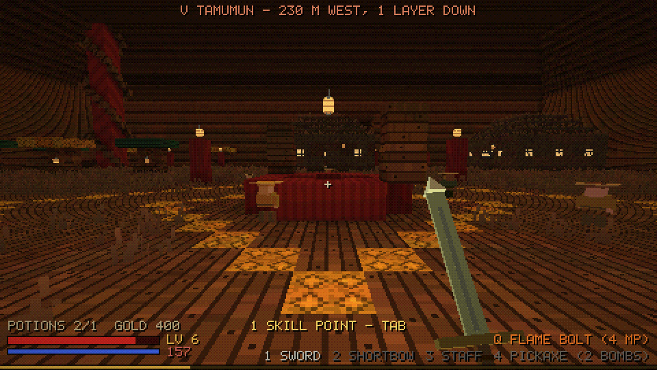
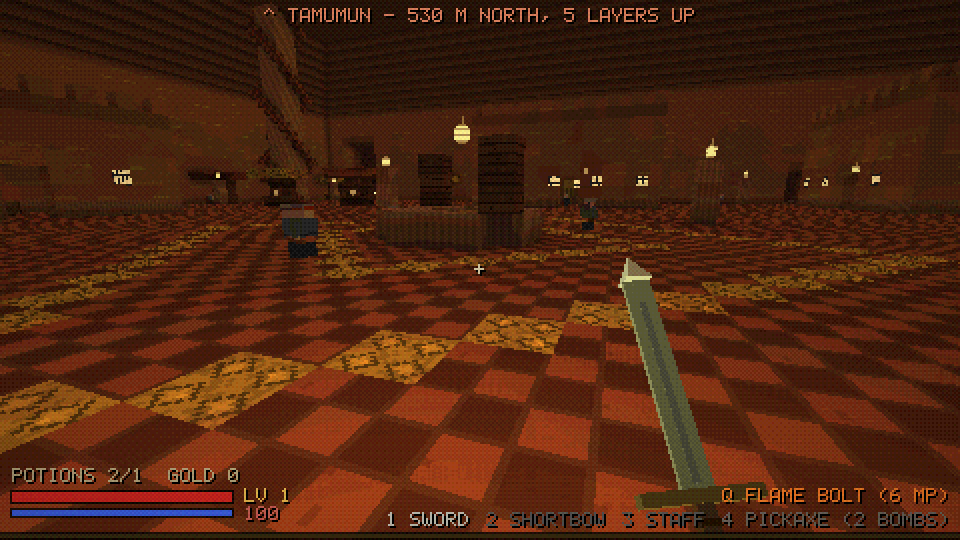
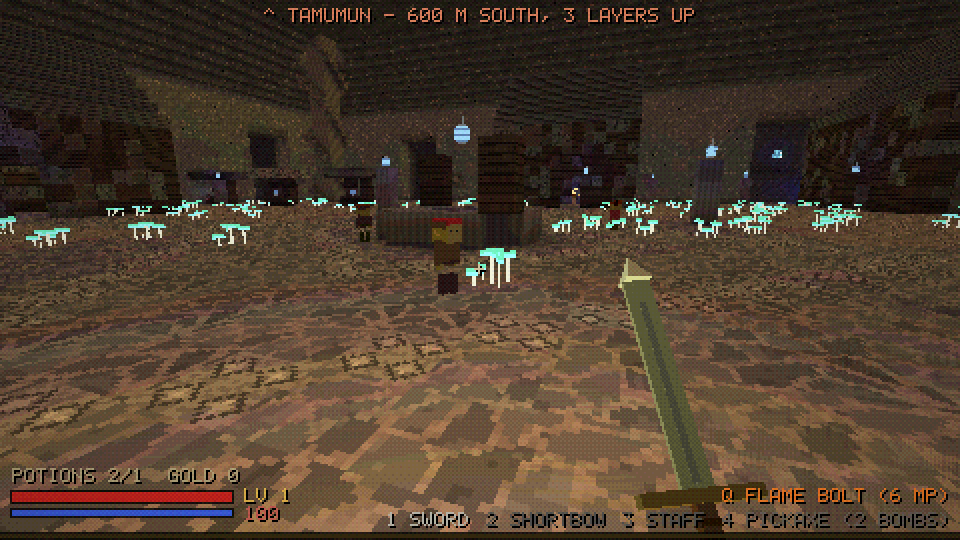
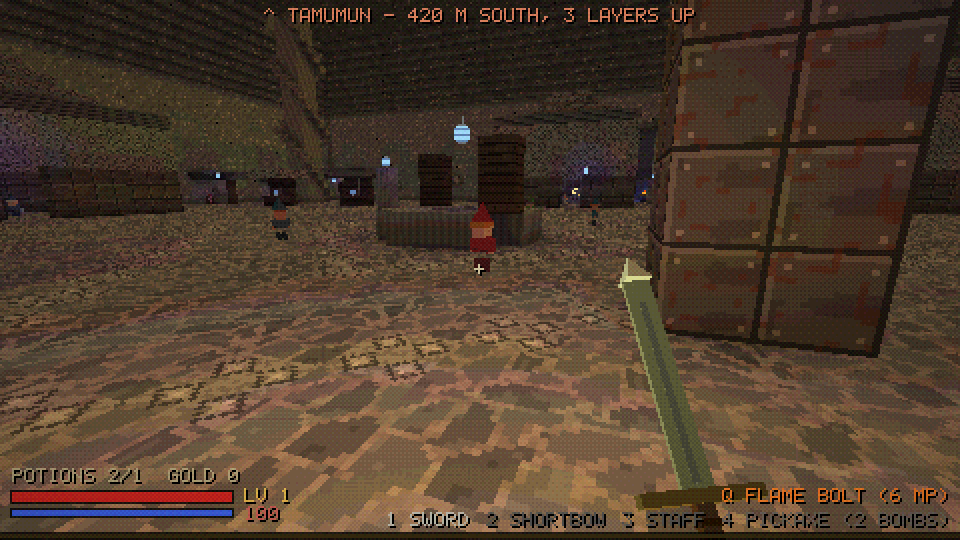
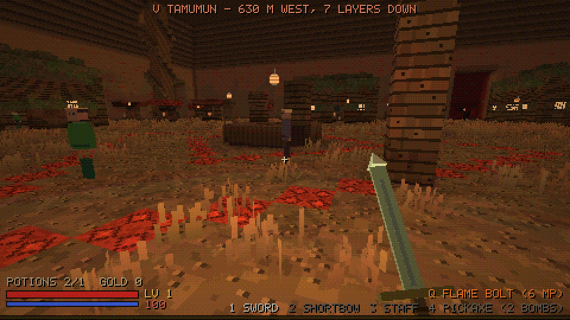
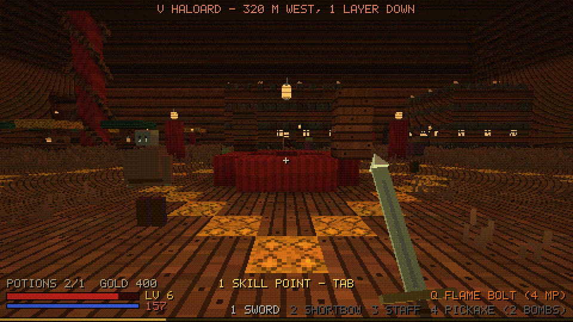

# The towns of the friendly peoples

Not everything in the fortress wants you dead. Seven peoples live in halls of their own: **dwarves,
goblins, gnomes, elves, humans, halflings and orcs**. You can trade with them, be healed, rest
in good company and help them.

| | | |
|---|---|---|
|  |  |  |
| the Halfling Burrows of Puddlebrook, the first town of seed 1337 | a Dwarven Hall | a Goblin Warren |
|  |  |  |
| a Gnomish Clockworks | an Elven Grove | the Orcish Clanhold of Ugbash (seed 42) |

## Where they are

A town is a great hall of three by three chunks. About a third of the one-layer megastructures
(halls and caverns) become towns, and **there is always one on the gate's layer, about 200 m east of
the gate**. Seed 1337 has 18 towns within 18 chunks and 6 layers of the gate. Who lives in a town
depends on the depth:

- dwarves and humans in the mines and the dungeon
- goblins in the roots and the fungal deep
- gnomes in the crystal abyss and the orrery
- orcs in the inferno and the iron hells
- elves and halflings in the gardens and the heavens

Its name comes from the people and the seed: the Dwarven Hall of Grimhold, the Goblin Warren of
Fizzbottom, the Gnomish Clockworks of Fizzlespring, the Elven Grove of Aelwen, the Human Town of
Stonebury, the Halfling Burrows of Puddlebrook, the Orcish Clanhold of Ugbash.

Every town has the same plan in its people's style:
- a plaza with a well in the middle, under a vaulted roof
- an inn, a temple with a shrine (it sets your respawn and opens the shop), the elder's hall, a
  workshop and two houses
- a market with stalls, and a garden, in the corners where the stairs come up and go down
- a road round the walls that joins the passages in

The styles:
- dwarves build in dressed stone with flat roofs
- goblins in scrap and wood, with fungus about
- gnomes in brass under brass domes, with a clock tower
- elves in living wood under leaves, with a great tree on the plaza
- humans in timber framing with pitched roofs
- halflings in turf mounds with grass on top
- orcs in iron-banded stone with bones on the parapets

The lamps light a town warmly everywhere.

## Safe ground

No monster is born in a town and nothing there can be dug or blasted. Guards walk the road round
the walls and shoot anything hostile that follows you in. Rifts never open in a town.

## The people

About twenty live in a town: the innkeeper, the healer, the elder, the smith, two merchants at
the stalls, three guards, families in the houses and folk and children about the plaza. Each has
a name of their people (Thrain Ironhand, Snikkit Toecutter, Fennel Cogsworth, Sylwen Dawnsong,
Maren Fletcher, Rosie Underhill, Grukk Skullsplitter). Each people has its own look:
- height and build
- skin, hair and clothes
- ears: long for elves, big for goblins, small and pointed for gnomes
- beards for dwarves
- tusks for orcs
- hats: gnomes' pointed hats, goblins' bandanas, dwarven helmets, elven circlets, halflings'
  straw hats

Come close and they turn to you and say who they are. **Strike at someone face to face to talk to
them.**

- **The innkeeper:** a bed and a meal for 15 gold plus 2 per danger level, free once you are
  honoured. Everything is healed, burns, poison and cold are gone, and you are well fed. You will
  wake there, and the game is saved. Good company by the fire gives **15 % more XP and twice the
  healing for 15 minutes**, and someone tells a tale from the world's history.
- **The healer:** wounds, burns, poison, cold and the after-effects of elixirs, for 10 gold plus 1
  per danger level, free for friends. Honoured guests also get a blessing that takes the next blows.
- **The merchants and the smith** open the market: the shop, with the people's own wares on top.
  - dwarves: iron, steel, a rare weapon, bombs, wine
  - goblins: slime, bat wings, mushrooms
  - gnomes: frost salts, growth tonics, bombs, quicksilver, lenses
  - elves: orchids, dew, herbs, potions, starfruit
  - humans: potions, grain, salt, spices, firewood
  - halflings: honey, melons, eggs, milk, seeds
  - orcs: a rare weapon, troll blood, fangs, goat meat, warming draughts
- **The elder** asks the town's task:
  - *drive off the beasts*: kill 5 to 8 monsters in the halls round the town
  - *bring what we need*: 2 to 4 of something the people use, such as honey for halflings,
    lenses for gnomes or fangs for orcs
  - *someone is lost*: a named townsperson in a chunk a few out, kept there by monsters; find
    them and speak to them
  - *a beast has its lair*: a named boss ("the Gnawer", "Old Tusk", "the Hollow Mother"...) to
    kill

  The newest task shows under the story's line, with the way to go. Done, it pays gold (more
  for goblins), a gift of the people's craft and their good opinion:
  - dwarven steel
  - gnomish flasks
  - an elven orchid and a draught
  - human healing potions
  - a halfling hamper of honey, starfruit and seeds
  - an orcish weapon
- **Everyone else** keeps you company. They talk of their lives and their people's ways, and of
  the history with the world's own names. They tell you where they last saw the one you hunt, and
  remind you when their town needs help.

## Reputation

Each town remembers you:

| Standing | Reputation | What it gives |
|---|---|---|
| stranger | 0 | |
| guest | 1-2 | (you spoke to them) |
| friend | 3-5 | 20 % off at the market, free healing |
| honoured | 6-9 | 35 % off, a free bed, a blessing from the healer |
| kin | 10+ | |

A task gives 1 reputation, or 2 for finding someone lost or killing a beast.

Reputation, the tasks, who asked them and the company at the inn are saved with the world (save
version 26).

## How it is built

- `src/world/towns.h`, `towns.c`: the peoples and the plan of a town.
  - the seven peoples: names, place names, looks, house style, wares, needs, what they say
  - who lives at what depth
  - the plan from a town's structure: lots, buildings, doors, where the keepers stand, stalls
- `src/world/layout.c`: towns are halls of variant `HALL_TOWN`, 3 × 3 chunks, the people stored
  in the structure. The first town is pinned east of the gate.
- `src/world/gen_town.c`: the generator. The vault, the floor, the buildings in each people's
  style with their furniture (counter and beds, altar and shrine, high seat, forge and anvil),
  the market, the garden, the plaza, the lamps, then the stairs and the passages in.
- `src/game/town.c`: the people, talking, the inn, the healer, the market, the tasks, reputation,
  guards, drawing and the task line.
- `tests/test_worldgen.c` checks that the first town is there, that its plaza has a floor and
  room to stand, and that every building's door is open with room for its keeper.
- `--demo town` puts you in the first town's plaza. `--demo towntest` talks to everyone there,
  rests, is healed, buys at the market, and does the elder's task, logging each step.
